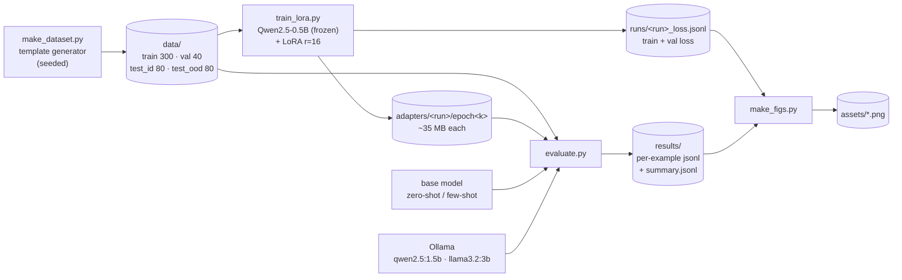
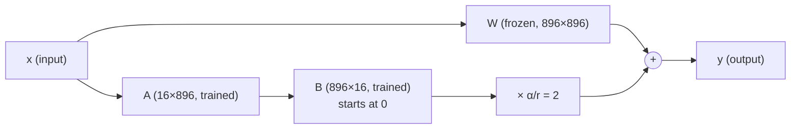
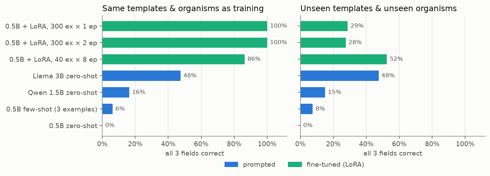
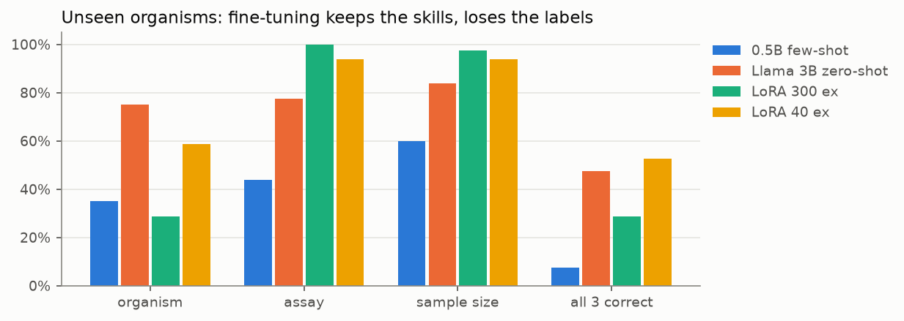
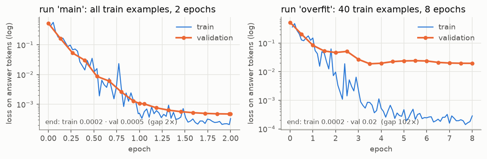

# Fine-tuning a small LLM with LoRA: messy methods sections → structured JSON

This project fine-tunes **Qwen2.5-0.5B-Instruct** with **LoRA** (Hugging Face PEFT) for one narrow job. It reads the messy methods section of a biology paper and returns

```json
{"organism": "Mus musculus", "assay": "Western blot", "sample_size": 24}
```

It then compares the fine-tuned model against **prompting the same base model**, zero-shot and few-shot, and against larger prompted models served by Ollama.

What you learn:

| Concept | Where it shows up |
|---|---|
| **Parameter-efficient fine-tuning (LoRA)** | Training 8.8 M of 503 M weights (1.75 %), on a laptop CPU · [§5](#5-how-lora-works-and-the-settings-used-here) |
| **Dataset formatting** | Chat template, loss masking, end-of-turn token · [§6](#6-dataset-formatting-what-the-model-actually-sees) |
| **Overfitting** | Loss curves, a 40-example × 8-epoch run, and a held-out test set that validation loss can't see · [§9](#9-overfitting) |
| **When fine-tuning beats prompting** | Head-to-head on two test sets that tell different stories · [§8](#8-results), [§10](#10-when-does-fine-tuning-beat-prompting) |

> **TL;DR of the results.**
> * On test data that looks like the training data, the fine-tuned 0.5 B model gets **100 %** of examples fully right. Prompting the same model gets **0 %** zero-shot and **6 %** few-shot, and a **6× larger prompted model (Llama 3.2 3B) gets 48 %**. The fine-tuned model is also the fastest.
> * On test data with **organisms it never saw in training**, the fine-tuned model drops to **29 %**, below the prompted 3B model (48 %). It confidently maps rabbits to *Rattus norvegicus* and pigs to *Homo sapiens*.
> * A model fine-tuned on only **40 examples** scores lower on familiar data (86 %) but **higher on unseen organisms (52.5 %)**, because it drifted less from the base model.
>
> Fine-tuning taught the task's conventions far better than prompting could, and it also narrowed the model's answers toward the training labels.

> **Charts.** The PNGs in [`assets/`](assets/) are made from the real logs in [`runs/`](runs/) and [`results/`](results/) by `make_figs.py`. Diagrams are Mermaid. GitHub renders them as is; in VS Code, install **Markdown Preview Mermaid Support** (`bierner.markdown-mermaid`).

---

## 1. Pipeline



* **Everything runs on CPU.** This laptop (4-core Intel i7, 16 GB RAM, no GPU) is the reason for several choices below.
* **Every stage writes to disk.** You can stop after any stage and resume later; nothing needs to stay in memory.

### Files

| File | What it does |
|---|---|
| [`make_dataset.py`](make_dataset.py) | Generates synthetic methods sections with known labels and writes the four splits to `data/` |
| [`common.py`](common.py) | The system prompt, model loading, batched generation, JSON parsing and per-field scoring. Shared by training and evaluation |
| [`train_lora.py`](train_lora.py) | Wraps the base model with LoRA and runs an explicit PyTorch training loop. Logs loss and saves an adapter per epoch |
| [`evaluate.py`](evaluate.py) | Scores one method on one test split. Saves every raw model output so you can read the failures |
| [`make_figs.py`](make_figs.py) | Rebuilds the charts in `assets/` |
| [`run_all.sh`](run_all.sh) | Runs the whole pipeline end to end |

---

## 2. Setup

Developed with Python 3.12, torch 2.2.2 (CPU), transformers 4.41.2, peft 0.11.1 and accelerate.

```bash
python -m venv .venv && source .venv/bin/activate
pip install -r requirements.txt
PY=python
```

The first run downloads `Qwen/Qwen2.5-0.5B-Instruct` (~1 GB) into `~/.cache/huggingface`. The Ollama baselines need the Ollama app running with `qwen2.5:1.5b` and `llama3.2:3b` pulled.

Only the final adapter, `adapters/main/epoch2/`, is committed to the repo (~35 MB). The other adapters (`main/epoch1`, `overfit/epoch1…8`) are regenerated by the training step.

> **Why not Unsloth or QLoRA?** Both need an NVIDIA GPU. Unsloth is built on CUDA kernels, and QLoRA's 4-bit quantization uses `bitsandbytes`, which has no Intel-Mac CPU backend. Plain LoRA in fp32 on the CPU is the same algorithm minus the quantization. [§5](#5-how-lora-works-and-the-settings-used-here) explains what QLoRA would add.

---

## 3. How to run

### Everything in one go (~5–6 h on this laptop)

```bash
./run_all.sh                    # dataset → 2 training runs → all evals → charts
SKIP_TRAIN=1 ./run_all.sh       # reuse existing adapters, just re-evaluate
SKIP_OLLAMA=1 ./run_all.sh      # skip the larger-model baselines
```

Long runs are easiest left in the background: `nohup ./run_all.sh > run_all.log 2>&1 &`.

### Stage by stage

| Step | Command | Writes | Time here |
|---|---|---|---|
| 1. Make data | `$PY make_dataset.py` | `data/*.jsonl` | 1 s |
| 2. Train | `$PY train_lora.py --run main` | `adapters/main/epoch{1,2}/`, `runs/main_loss.jsonl` | ~1 h 50 min (about 40 % of it is val-loss checks) |
| | `$PY train_lora.py --run overfit --n_train 40 --epochs 8 --grad_accum 4` | `adapters/overfit/epoch1…8/` | ~1 h 15 min |
| 3. Evaluate | `$PY evaluate.py --mode zero_shot --split test_id` | `results/test_id__zero_shot.jsonl`, a row in `results/summary.jsonl` | 6–15 min per (mode, split) |
| | `$PY evaluate.py --mode few_shot --split test_ood` | | |
| | `$PY evaluate.py --mode lora --adapter adapters/main/epoch1 --split test_ood` | | |
| | `$PY evaluate.py --mode ollama:llama3.2:3b --split test_ood` | | |
| 4. Charts | `$PY make_figs.py` | `assets/loss_curves.png`, `assets/accuracy.png` | 2 s |

Useful flags:

* `train_lora.py` knobs: `--rank`, `--alpha`, `--lr`, `--epochs`, `--n_train`. Use `--eval_every 20` to cut the validation-loss checks, which take ~4.5 min each.
* `evaluate.py --limit 10` scores only the first 10 rows, for a quick check.

Add `-W ignore` after `$PY` (or `export PYTHONWARNINGS=ignore`) to hide harmless library warnings.

---

## 4. The task and the dataset

### The schema and its conventions

The system prompt (in [`common.py`](common.py), identical for every method) asks for exactly three keys:

| Key | Convention the model must follow |
|---|---|
| `organism` | **Latin binomial.** "C57BL/6J mice" → `Mus musculus`. Human cell lines (HeLa, HEK293T…) → `Homo sapiens`. **Ignore antibody host species** ("rabbit anti-GAPDH"). |
| `assay` | **One label from a fixed list of 11:** RNA-seq, single-cell RNA-seq, qPCR, Western blot, ELISA, flow cytometry, immunohistochemistry, ChIP-seq, mass spectrometry, calcium imaging, patch-clamp electrophysiology. "Immunoblotting" → `Western blot`. |
| `sample_size` | **Integer total** of subjects or biological replicates. "4 groups (n = 6 per group)" → `24`. "Biological triplicate" → `3`. Not stated → `null`. Technical replicates don't count. |

These conventions are what makes the task good for fine-tuning: they are rules a paper doesn't state, which a model either knows or doesn't.

### Why synthetic data

Real methods sections with clean labels would mean hand-annotating hundreds of papers. Instead, [`make_dataset.py`](make_dataset.py) assembles each example from sentence templates, so **the right answer is known exactly**. One training example:

```
The primary readout was transcriptome sequencing on an Illumina NovaSeq. All experiments
with budding yeast (W303) were performed in biological triplicate. Primary antibodies were
rabbit anti-GAPDH (1:5000, Cell Signaling #40755) and goat anti-mouse IgG. Incubation
lasted 24 h at 25 °C in a humidified chamber.
→ {"organism": "Saccharomyces cerevisiae", "assay": "RNA-seq", "sample_size": 3}
```

The "messy" part:

* **Distractor sentences with numbers.** Centrifuge speeds (`12000 × g`), dilutions (`1:5000`), catalog numbers, temperatures, protocol numbers, "mean ± SEM of 3 technical replicates".
* **Distractor organisms.** Antibody hosts (`rabbit anti-…`, `goat anti-mouse`) show up in studies of yeast, flies and humans.
* **Sample-size phrasings.** Total ("A total of 36 mice"), number words ("Twelve…"), per-group (needs multiplication), "triplicate", or absent.
* **PDF copy-paste noise.** Random sentence order, line-break hyphenation (`homo-\ngenized`), double spaces, stray newlines, citation brackets `[14]`.

### The four splits

| Split | n | Templates | Organisms | Purpose |
|---|---|---|---|---|
| `train` | 300 | in-distribution | 9 species (+ human cell lines) | training |
| `val` | 40 | in-distribution | same 9 | validation-loss curve during training |
| `test_id` | 80 | in-distribution | same 9 | "Can it do the task it was trained on?" |
| `test_ood` | 80 | **new sentence templates** | **4 new species**: rabbit, pig, *Xenopus*, chicken | "Did it learn the skill, or the training set?" |

All texts are unique across splits. Assay labels are the same 11 in every split, since the vocabulary is closed and listed in the prompt.

`test_ood` is the most important design choice in the project. Validation loss and `test_id` both come from the training distribution, so neither can show overfitting to that distribution.

---

## 5. How LoRA works, and the settings used here

A full fine-tune updates every weight matrix **W** (here 896×896 up to 896×4864, in each of 24 layers). LoRA freezes **W** and learns a **low-rank update** instead:

```
W_effective = W + (α / r) · B · A        A: r × d_in,  B: d_out × r,  r ≪ d
```



* **B starts at zero,** so at step 0 the fine-tuned model is exactly the base model. Training only moves it away as far as the data asks.
* **Rank r = 16** caps how much the update can express. Narrow tasks need very little.
* **α = 32** scales the update (α/r = 2). If you change r, keep α ≈ 2r so the learning rate stays sensible.
* **Targets:** all 7 linear layers in every transformer block (`q,k,v,o` attention projections and `gate,up,down` MLP projections).

**Counting the trainable parameters.** Each adapted layer adds r·(d_in + d_out) weights. Qwen2.5-0.5B has hidden size 896, MLP size 4864, and 2 key/value heads × 64 dims = 128 for k and v:

| Layer | d_in + d_out | × r = 16 |
|---|---|---|
| q_proj, o_proj | 896 + 896 | 28,672 each |
| k_proj, v_proj | 896 + 128 | 16,384 each |
| gate_proj, up_proj, down_proj | 896 + 4864 | 92,160 each |
| **per block** | | **366,592** |
| **× 24 blocks** | | **8,798,208** (1.75 % of 503 M) |

That matches PEFT's `print_trainable_parameters()` exactly. The saved adapter is ~35 MB, versus ~2 GB for the full model in fp32. You could keep one adapter per task and swap them on a single base model.

**QLoRA** is the same thing with the frozen **W** stored in 4-bit (NF4) instead of 16/32-bit. That cuts base-model memory about 4–8×, which is what lets people fine-tune 7–70 B models on one GPU. The adapters A and B still train in 16-bit. At 0.5 B on a 16 GB machine, memory isn't the bottleneck, so QLoRA would add nothing here even if it ran.

### Training settings ([`train_lora.py`](train_lora.py))

| Setting | Value | Why |
|---|---|---|
| precision | fp32 | bf16 on this CPU (no AVX-512) is slower than fp32 |
| optimizer | AdamW, lr 2e-4, no weight decay | Standard LoRA learning rate (~10× higher than full fine-tuning) |
| schedule | 10 % linear warmup, then linear decay to 0 | |
| batch | 1 example per forward pass, **gradient accumulation 8** | Effective batch of 8 without padding waste |
| gradient clipping | 1.0 | Guards against early spikes |
| epochs | 2 (76 optimizer steps) | Validation loss had flattened by the end of epoch 1 |
| LoRA dropout | 0.05 | Mild regularization on the adapter input |

The loop is written out by hand rather than with `Trainer`, so each of these is one visible line.

---

## 6. Dataset formatting: what the model actually sees

An instruct model was trained on conversations in a specific **chat template**. Fine-tuning data must use the same template, or you are teaching the model a new format on top of the task. For Qwen it looks like this:

```
<|im_start|>system
You extract structured data from the methods sections of biology papers. Return ONLY a JSON object …<|im_end|>
<|im_start|>user
The primary readout was transcriptome sequencing on an Illumina NovaSeq. All experiments …<|im_end|>
<|im_start|>assistant
{"organism": "Saccharomyces cerevisiae", "assay": "RNA-seq", "sample_size": 3}<|im_end|>
```

`tokenizer.apply_chat_template(...)` produces this, so the code never hard-codes it.

Three formatting decisions in `encode()` matter:

1. **Loss masking.** The labels are `-100` (ignored) for every prompt token. The model is graded **only on the ~29 answer tokens,** not on reproducing the ~312-token prompt. Without masking, most of the gradient would go into memorizing the system prompt and the input text.
2. **End the target with `<|im_end|>`.** That's how the model learns to stop. Leave it out and the fine-tuned model keeps generating after the closing brace.
3. **One canonical target string.** `json.dumps` with a fixed key order and spacing. Consistent targets are easier to learn than paraphrases of the same answer.

The **same system prompt** is used for zero-shot, few-shot and the fine-tuned model, so each comparison isolates one thing: the examples, or the weights.

---

## 7. The methods being compared

| Method | Prompt | Weights | Prompt length |
|---|---|---|---|
| `zero_shot` | system prompt + text | base Qwen2.5-0.5B-Instruct | ~312 tokens |
| `few_shot` | + 3 worked examples from `train` | base | ~823 tokens |
| `lora-main-epoch1/2` | system prompt + text | base + LoRA trained on 300 examples, after epoch 1 or 2 | ~312 tokens |
| `lora-overfit-epoch8` | system prompt + text | base + LoRA trained on 40 examples × 8 epochs | ~312 tokens |
| `ollama-qwen2.5-1.5b` | system prompt + text | 3× larger, same family (4-bit GGUF) | ~312 tokens |
| `ollama-llama3.2-3b` | system prompt + text | 6× larger, different family (4-bit GGUF) | ~312 tokens |

The few-shot examples are fixed, chosen to cover different cases: a per-group count (mice, ChIP-seq, n = 16), a human cell line (scRNA-seq, n = 4), and a missing sample size (mice, ELISA, null).

All decoding is **greedy** (temperature 0), so results are deterministic. Scoring in [`common.py`](common.py) is a case-insensitive exact match per field. "Strict JSON" means the entire output parses as JSON; the lenient parser also accepts a `{…}` buried in prose or a ```` ```json ```` fence.

---

## 8. Results



### Test set 1: same templates and organisms as training (`test_id`, n = 80)

| Method | strict JSON | organism | assay | sample size | **all 3** | s / example |
|---|---|---|---|---|---|---|
| zero-shot | 80 % | 1 % | 18 % | 55 % | **0 %** | 7.4 |
| few-shot | 100 % | 39 % | 36 % | 63 % | **6 %** | 11.0 |
| LoRA, epoch 1 | 100 % | 100 % | 100 % | 100 % | **100 %** | 4.8 |
| LoRA, epoch 2 | 100 % | 100 % | 100 % | 100 % | **100 %** | 4.8 |
| LoRA, 40 examples × 8 epochs | 100 % | 97.5 % | 90 % | 97.5 % | **86 %** | 4.9 |
| Qwen2.5 1.5B zero-shot (Ollama) | 46 % | 28 % | 76 % | 64 % | **16 %** | 5.0 |
| Llama 3.2 3B zero-shot (Ollama) | 100 % | 73 % | 79 % | 75 % | **48 %** | 8.7 |

### Test set 2: new templates and new organisms (`test_ood`, n = 80)

| Method | strict JSON | organism | assay | sample size | **all 3** | s / example |
|---|---|---|---|---|---|---|
| zero-shot | 73 % | 11 % | 16 % | 49 % | **0 %** | 5.6 |
| few-shot | 100 % | 35 % | 44 % | 60 % | **7.5 %** | 10.2 |
| LoRA, epoch 1 | 100 % | 29 % | 100 % | 97.5 % | **29 %** | 4.6 |
| LoRA, epoch 2 | 100 % | 27.5 % | 100 % | 95 % | **27.5 %** | 4.6 |
| LoRA, 40 examples × 8 epochs | 100 % | 59 % | 94 % | 94 % | **52.5 %** | 4.8 |
| Qwen2.5 1.5B zero-shot (Ollama) | 39 % | 41 % | 74 % | 49 % | **15 %** | 4.7 |
| Llama 3.2 3B zero-shot (Ollama) | 100 % | 75 %\* | 78 % | 84 % | **48 %** | 9.9 |

\* Llama 3B answered `Gallus gallus domesticus` for 19 of the 20 chicken studies. That's a valid name for the domestic chicken, but the exact-match scorer counts it wrong. Counted as correct, its organism score would be 99 %. A real evaluation would need a synonym list, which is a reminder that **your metric is part of your task definition.**

Latency is wall-clock on this CPU, excluding model load. The Hugging Face runs use batch size 8; Ollama runs one request at a time with 4-bit weights. Timings vary by ±30 % with whatever else the laptop is doing.



### What the base model gets wrong (zero-shot)

The base model writes JSON, but it doesn't follow the conventions:

```
{"organism": "E. coli", "assay": "ChIP-seq", "sample_size": 4, "method": "ChIP-seq"}
{"organism": "worms", "assay": ["cytometric analysis"], "sample_size": 250, "method": "BD LSRFortessa"}
```

* **Organism:** it copies the surface mention (`zebrafish`, `A. thaliana`, `mouse`, `human`) instead of the binomial. 1 % correct.
* **Assay:** it copies the paper's phrase ("chromatin immunoprecipitation followed by sequencing", "RT-qPCR") instead of mapping to the list, and often returns a list instead of a string.
* **Extra keys** such as `"method"`, and sometimes markdown fences or invented nested objects that break parsing.
* **Sample size:** it picks up distractor numbers or forgets to multiply per-group counts.

### What few-shot gets wrong: copying the examples

Three examples fixed the format completely (100 % strict JSON), but a 0.5 B model **copies its examples instead of generalizing from them**:

* It answered *Mus musculus* **35 times** on `test_id`, where only **4** examples are mice. Two of the three examples were mice.
* When it got the assay wrong, it usually answered `ChIP-seq`, the first example's assay.
* Several sample-size errors are exactly `16`, the first example's count.

It is also the slowest method: the ~823-token prompt has to be processed for every input.

### What LoRA gets wrong: it narrows to the organisms it saw

On `test_ood` the fine-tuned model stays near-perfect on **assay (100 %)** and **sample size (95–97.5 %)**, even though every sentence template is new. It learned the reading skill, not the surface wording.

**Organism collapses**, though. Here is what epoch 1 answered for the four species it never saw in training:

| True organism | LoRA, 300 examples | LoRA, 40 examples | Llama 3B, prompted |
|---|---|---|---|
| chickens, *Gallus gallus* (20) | ✅ 19 · `Gallus domesticus` 1 | ✅ 20 | `Gallus gallus domesticus` 19 · ✅ 1 |
| pigs, *Sus scrofa* (20) | ✅ 4 · **`Homo sapiens` 16** | ✅ 18 · `Homo sapiens` 1 · `Susquehanna` 1 | ✅ 20 |
| rabbits, *Oryctolagus cuniculus* (18) | **`Rattus norvegicus` 17** · `Homo sapiens` 1 | **`Rattus norvegicus` 17** · `Homo sapiens` 1 | ✅ 17 · `Rattus norvegicus` 1 |
| *Xenopus laevis* (22) | **`Rana sylvatica` 15** · `C. elegans` 6 · `Danio rerio` 1 | ✅ 9 · `C. elegans` 7 · *Rana* 4 · other 2 | ✅ 22 |

Three lessons here:

1. **Fine-tuning narrows the output distribution.** Three hundred examples covering only 9 species taught the model that the answer is almost always one of those 9. With an unfamiliar organism, it reaches for the nearest familiar label. The base model's general knowledge isn't gone (it gets *Gallus gallus* right), but it is outvoted.
2. **It learns rules you didn't intend.** In training, "rabbit" only ever appears as an **antibody host**, which the prompt says to ignore. Both fine-tuned models learned "rabbit is never the answer" and map rabbit studies to rats. Even 40 examples were enough to learn this.
3. **Prompting doesn't have this failure mode.** The prompted 3B model knows all four species. Even the 0.5B few-shot model got *Xenopus laevis* right 16 times out of 22; the 300-example LoRA model got it right 0 times.

### What the larger prompted models get wrong

* **Qwen 1.5B** is good at the assay vocabulary (~75 %), but it still often answers with the surface name ("zebrafish", "C. elegans"). It wraps most answers in ```` ```json ```` fences, which is why its strict-JSON rate is under 50 %.
* **Llama 3B** is the only prompted model that mostly follows the conventions, and it's steady across both test sets (48 % and 48 %). Its errors are spread out: per-group counts not multiplied, some assay paraphrases, and over-specific names like *Gallus gallus domesticus*. It is also the slowest: ~9 s per example even with 4-bit weights.

---

## 9. Overfitting



Two training runs, same settings except data size:

| Run | Training data | Epochs | Optimizer steps | Final train loss | Final val loss | Gap |
|---|---|---|---|---|---|---|
| `main` | 300 examples | 2 | 76 (batch 8) | 0.0002 | **0.0005** | 2× |
| `overfit` | 40 examples | 8 | 80 (batch 4) | 0.0002 | **0.02** | **~100×** |

Both runs drive training loss to the same near-zero value: each model can reproduce its own training answers perfectly. But only the 300-example model also gets near zero on the 40 validation examples. The 40-example model **memorized its training set** and stalls at a validation loss 40× higher. Its in-distribution accuracy (86 % vs 100 %) shows the cost: with 40 examples, several assays and phrasings were seen only once or twice.

### What the curves do and don't show

* **The textbook U-shape is mild here.** Validation loss for the 40-example run bottomed out at 0.019 at epoch 3.5, rose to 0.024 by epoch 5.5, then drifted back down to 0.0196 as the learning rate decayed to zero. **The gap is the clearer signal**: training loss kept falling by 100× while validation loss went nowhere.
* **Validation loss can't see distribution shift.** In the main run, validation loss fell the whole way (0.53 → 0.0005). Yet on `test_ood`, epoch 2 was slightly *worse* than epoch 1 (27.5 % vs 29 % all-correct). Validation data comes from the training distribution, so it can only tell you about memorization *within* that distribution.

### The surprise: less training generalized better to new organisms

| | `test_id` all-correct | `test_ood` all-correct |
|---|---|---|
| LoRA, 300 examples × 2 epochs | **100 %** | 27.5 % |
| LoRA, 40 examples × 8 epochs | 86 % | **52.5 %** |

The model that "overfit" by the usual definition beats the well-trained one on unseen organisms, and also beats the prompted 3B model (48 %). A likely explanation: with 40 examples there were fewer updates pushing the organism field toward the 9 training labels, so more of the base model's knowledge survived. The 300-example model saw each of the 9 species 27–42 times. *Homo sapiens* (30 examples) covers the most varied wording (participants, patients and four cell lines), which may be why it became the fallback answer for pigs.

This is a single run per setting, so treat it as a hypothesis rather than a law. The pattern is well known, though: **the more a model specializes in the training distribution, the more it can lose outside it.** There isn't one "best" checkpoint. It depends on how much real inputs will differ from the training data, which is why you need a test set that differs in the ways reality will.

---

## 10. When does fine-tuning beat prompting?

What this project showed, generalized:

| Fine-tuning wins when… | Prompting wins when… |
|---|---|
| The task has **conventions or a vocabulary the model doesn't know** and can't easily infer from a description: canonical names, closed label sets, "multiply per-group counts" | The model already knows how to do it and only needs to be told what to do |
| You have **hundreds of examples** that cover the inputs you will really see | You have a handful of examples, or none |
| **The output space is fixed** and covered by the training data | **New categories appear** at test time (new organisms, new products, new schema fields) |
| You need **a small, fast model**: short prompts, no examples in context, and short exact outputs | Latency and cost per call don't matter much |
| The format must be exact every time | Occasional format drift is fine, or you can use constrained decoding (e.g. Ollama's `format: "json"`) |
| The task is stable | The task or schema changes often. Editing a prompt takes minutes; retraining takes hours plus a new evaluation |

In numbers, from this project:

* **Fine-tuning a small model beat prompting a model 6× its size** on the task it was trained for: 100 % vs 48 % (Llama 3.2 3B), at about half the latency. Getting there took 300 synthetic examples and ~2 h of laptop CPU time.
* Fine-tuned, the 0.5 B model was **2.3× faster per call** than few-shot prompting of itself, because it needs no examples in the prompt.
* **On new label values, the larger prompted model won** (48 % vs 29 %). Its general knowledge of species names was intact; the fine-tuned model had traded some of its own away.
* **Less fine-tuning traded the other way:** 86 % in-distribution, but 52.5 % on new organisms.

**The practical recipe:** fine-tune for the format and the conventions, but make the training data cover the label space you expect in deployment. If new categories are likely, add a fallback: route low-confidence or unseen-label cases to a prompted (or larger) model.

---

## 11. Exercises

Ordered roughly from quickest to most involved.

1. **Read the failures.** `results/test_ood__lora-main-epoch1.jsonl` has every raw output. Filter for `"organism": false` and see whether the wrong answers depend on the sentence template or only on the organism.
2. **Fix the organism collapse with data.** Add 10–15 more species to `ORGANISMS_ID` in `make_dataset.py` (not the 4 OOD ones), retrain, and re-score `test_ood`. Does wider label coverage teach "use your knowledge of binomials" rather than "pick one of 9"?
3. **Make rabbit a real subject in training.** Add a rabbit study to the in-distribution organisms, so "rabbit" isn't only ever a distractor. Does that fix rabbit → rat in the OOD set even if you keep rabbits out of test?
4. **Learning curve.** Train with `--n_train 25`, `50`, `100`, `300` and plot all-fields accuracy on `test_id` and `test_ood` against the number of examples. How many examples does it take to beat few-shot?
5. **Rank sweep.** Try `--rank 2 --alpha 4` and `--rank 64 --alpha 128`. For a narrow task like this, does rank matter at all?
6. **Drop the system prompt.** Train and evaluate with a one-line instruction instead of the long system prompt. Fine-tuning can move the instructions into the weights; how much shorter (and faster) can the prompt get before accuracy drops?
7. **Constrained decoding.** Re-run the Ollama baselines with `"format": "json"` in the request (in `run_ollama()` in `evaluate.py`). That guarantees valid JSON. Does it improve anything besides validity?
8. **Real data.** Take 30 real methods sections from PubMed Central open-access papers, label them by hand, and score every method. Synthetic templates are much more regular than real writing, so expect all methods to drop.
9. **Merge the adapter.** `model.merge_and_unload()` folds B·A into W, giving a normal model with no PEFT dependency and no adapter overhead at inference. Check that the outputs are identical and compare latency.

---

## 12. Troubleshooting and caveats

* **`Special tokens have been added in the vocabulary…`** and other warnings printed at load time are harmless. Hide them with `-W ignore`.
* **Out of memory or very slow?** Lower `--max_len` or close other apps. Training holds ~2 GB of fp32 weights plus activations for one ~350-token sequence.
* **Results differ slightly between runs.** Generation is greedy and the data is seeded, but CPU math libraries aren't bit-for-bit deterministic across thread counts. Expect ±1–2 examples.
* **Synthetic data is easier than real data.** A perfect score on `test_id` says the model learned *these templates*; it does not say it would work on real papers. `test_ood` is a better guide, and real annotated papers would be better still (exercise 8).
* **Validation loss can't see out-of-distribution failures** ([§9](#9-overfitting)). Always keep a test set that differs from the training data in the ways real inputs will.
* **One run per setting.** Differences of 1–2 examples out of 80 (e.g. epoch 1 vs epoch 2) are within noise. The big gaps (0 % vs 100 %, 29 % vs 52.5 %) are not.
* **Exact-match scoring is strict.** It counts `Gallus gallus domesticus` as wrong; see the note under the results tables.
